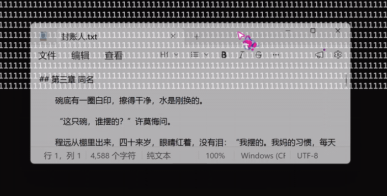

# see-through-window

把任意窗口变成**半透明、置顶**的参考浮层 —— **默认仍然可以正常操作它**。



> 演示为 4 倍速：窗口在半透明与不透明之间切换，背后的正文随之显出来。

`Windows 10 / 11` · `Python 3.8+` · `零第三方依赖` · `单文件`

## 目录

- [1. 它解决什么问题](#1-它解决什么问题)
- [2. 特性](#2-特性)
- [3. 安装与运行](#3-安装与运行)
- [4. 快速上手](#4-快速上手)
- [5. 功能详解](#5-功能详解)
- [6. 热键](#6-热键)
- [7. 配置文件](#7-配置文件)
- [8. 常见问题](#8-常见问题)
- [9. 已知限制](#9-已知限制)
- [10. 自检](#10-自检)
- [11. 原理](#11-原理)
- [12. 不做什么](#12-不做什么)

## 1. 它解决什么问题

- **跟着视频教程操作自己的软件**：教程挡住界面，来回切窗口很烦
- **对着设计稿调界面**：设计稿浮在上面，下面对照写代码
- **开会时把议程、笔记钉在角落**：浮着随时瞄一眼，又不挡你点别处

现有工具里，PowerToys 的「Always on Top」只能置顶，**不能调透明度**；
能调透明度的老工具（Glass2k / PeekThrough）早已停更，而且默认不可交互。

本工具把「透明度」和「是否可交互」拆成两个独立开关：**默认可交互**。

## 2. 特性

| 特性 | 说明 |
|---|---|
| **默认可交互** | 透明浮层照常能点、能滚动、能输入，不会一按就"点不动" |
| **穿透可选** | `Ctrl+Shift+Alt+X` 单独开关，默认关闭 |
| **热键可改** | 改 `config.ini`；撞车时明确告诉你是哪个键被占用 |
| **全局热键** | 在任何程序里都生效，不用先切回本工具 |
| **精确还原** | 记住窗口被改动前的原始样式，一键写回，不留副作用 |
| **零依赖** | 只用 Python 标准库（`ctypes` 直调 Win32），不装 pip 包 |
| **单文件** | 一个 `.py`，拷走就能跑 |
| **崩溃自愈** | 进程被强杀也能在下次启动时自动恢复窗口 |

## 3. 安装与运行

### 环境要求

| 项目 | 要求 |
|---|---|
| 系统 | Windows 10 / 11 |
| Python | 3.8 及以上 |
| 依赖 | **无**，不需要 `pip install` |

建议使用 [python.org](https://www.python.org/downloads/) 安装的 Python。
微软商店版（MSIX 打包）不支持经典托盘 API，**托盘图标不会出现**（其余功能正常）。

### 获取代码

```bash
git clone https://github.com/009YK900/see-through-window.git
cd see-through-window
```

或者点页面右上角 **Code → Download ZIP** 下载解压。

### 启动

```bash
python see_through_window.py
```

不想要控制台窗口：

```bash
pythonw see_through_window.py
```

也可以直接双击 `start-see-through-window.vbs` 静默启动。

### 退出

按 `Ctrl+Shift+Alt+Q`，或在终端里 `Ctrl+C`。
两种方式都会**先还原所有被改过的窗口**再退出。

## 4. 快速上手

1. 用鼠标点一下要操作的那个窗口，让它在前台
2. 按 `Ctrl+Alt+G`
3. 再按一次 `Ctrl+Alt+G` 还原

> 本工具只作用于**当前前台窗口**。如果焦点在终端上，按热键作用到的就是终端自己。

## 5. 功能详解

### 参考窗模式

按 `Ctrl+Alt+G`，当前窗口变为**置顶 + 70% 不透明**，鼠标照常可用。
再按一次，精确还原到改动前的状态。

### 不透明度

提示条里的数字是**不透明度（opacity）**，不是透明度：

| 显示 | 含义 |
|---|---|
| `100%` | 完全不透明，和原样一样 |
| `70%` | 七成不透明，背后能透出三成（参考窗默认值） |
| `20%` | 很淡，几乎只看得到轮廓 |

**数字越小越透明。** 用 `Ctrl+Alt+[` / `Ctrl+Alt+]` 调整，下限 20%。

### 点击穿透

按 `Ctrl+Shift+Alt+X` 开启：该窗口不再响应鼠标，点击落到下面那层。默认关闭。

穿透窗口**点不到鼠标**，只能用热键关掉（热键是全局的，不看焦点）。
所以默认**同一时刻只允许 1 个窗口处于穿透状态**：

> 只要有一个窗口在穿透，无论当前前台是哪个窗口，按热键操作的都是**那一个**。

想把穿透换到另一个窗口，连按两次即可：第一次关掉原来那个，第二次开新的。

## 6. 热键

| 热键 | 作用 |
|---|---|
| `Ctrl+Alt+G` | **参考窗模式**：置顶 + 70% 不透明，鼠标仍可操作（再按一次还原） |
| `Ctrl+Alt+T` | 只切换置顶 |
| `Ctrl+Shift+Alt+X` | 点击穿透（可选，默认关） |
| `Ctrl+Alt+[` | 更透明（不透明度 -10%） |
| `Ctrl+Alt+]` | 更不透明（不透明度 +10%） |
| `Ctrl+Alt+0` | 还原当前窗口；若前台窗口没被改过，则还原所有窗口 |
| `Ctrl+Shift+Alt+Q` | 退出 |

有托盘图标时，右键托盘 → 还原所有窗口 / 快捷键说明 / 退出。

## 7. 配置文件

首次启动会在脚本旁边生成 `config.ini`：

```ini
# 同一时刻最多允许几个窗口处于穿透状态
max-through = 1

ghost = ctrl+alt+g
top = ctrl+alt+t
through = ctrl+shift+alt+x
alpha-down = ctrl+alt+[
alpha-up = ctrl+alt+]
reset = ctrl+alt+0
quit = ctrl+shift+alt+q
```

- 修饰键：`ctrl` / `alt` / `shift` / `win`，可任意组合
- 主键：`a-z`、`0-9`、`f1-f24`、符号键 `[ ] ; ' , . / \ - =`，以及 `space` / `tab` / `enter` / `esc`
- `max-through`：`1` 只允许一个（默认）、`2` 及以上允许这么多个、`0` 不限制
- **改完重启工具生效**

### 热键被占用了

Windows 的全局热键**先到先得**。如果某个组合已经被别的程序注册，
本工具就注册不上，按下去触发的是那个程序。

先检查当前配置的可用性：

```bash
python see_through_window.py --check-hotkeys
```

```
热键可用性检查：C:\...\config.ini

  [可用] Ctrl+Alt+G           参考窗模式（置顶 + 透明，可交互）
  [占用] Ctrl+Alt+T           只切换置顶  <- 被别的程序占用
  ...
```

看到 `[占用]` 就改 `config.ini` 里对应那行，重启即可。
启动时终端也会打印同样的注册结果。

## 8. 常见问题

**按热键没反应？**
八成是被别的程序占用了。跑一次 `--check-hotkeys` 看是哪一条，改 `config.ini`。

**托盘图标不显示？**
你用的是微软商店版 Python，它不支持经典托盘 API。换成 python.org 版本即可，其余功能不受影响。

**未开启穿透，却点不到窗口？**
先按 `Ctrl+Alt+0` 还原该窗口。若仍无效，可能是窗口本身是管理员权限运行。

**某个窗口加了透明后变黑 / 看不出透明？**
少数全屏游戏、部分 Electron / UWP 应用由 GPU 直接呈现，加上分层属性后就是这个表现。系统限制，不是 bug。

**提示「这个窗口改不了样式」？**
该窗口以管理员身份运行，普通权限改不了（Windows UIPI）。需要用同等权限运行本工具。

**程序被强杀后，窗口卡在半透明怎么办？**
重新启动一次本工具即可，会自动恢复上一次的残留状态。

**穿透之后点不到窗口了？**
这是穿透的预期行为。按同一个热键关闭；若焦点已切走，按 `Ctrl+Alt+0` 保底还原所有窗口。

## 9. 已知限制

- **只作用于前台窗口**：不做窗口列表，不做批量管理
- **跳过**：桌面 / 任务栏、本工具自身的窗口、不可见窗口
- **管理员窗口改不了**：普通权限下无法修改其样式
- **GPU 直呈窗口**：可能变黑或看不出透明
- **不持久化**：关掉程序，所有窗口回到原样；下次启动重新开始

## 10. 自检

不显示窗口（只在末尾闪一下提示条），验证 Win32 这一层是否正常工作：

```bash
python see_through_window.py --selftest
```

检查项：窗口创建、扩展样式置位与还原、分层透明度、热键注册、托盘可用性、
提示条绘制、参考窗模式状态机、单一穿透限制、配置解析、崩溃自愈。

## 11. 原理

1. **改扩展样式** —— `SetWindowLongPtrW(GWL_EXSTYLE)` 上加/去三个位：
   `WS_EX_TOPMOST`（置顶）、`WS_EX_LAYERED`（允许半透明）、`WS_EX_TRANSPARENT`（鼠标穿透）
2. **设不透明度** —— `SetLayeredWindowAttributes(hwnd, 0, alpha, LWA_ALPHA)`
3. **收热键** —— `RegisterHotKey`，消息循环里处理 `WM_HOTKEY`

干净的还原需要两步：第一次改动前把窗口**原始的**扩展样式存下来，还原时写回去——
否则会把窗口原本就有的属性一起抹掉。
